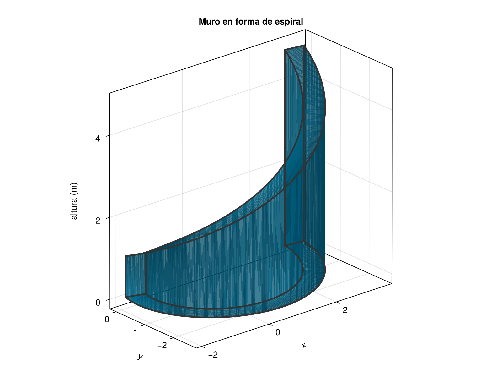

:::{#exr-1}
Usar sumas de Riemann para calcular la integral de Riemann de la función $f(x) = |2x^2-3x|$ en el intervalo $[1, 3]$.
:::

:::{.callout-tip collapse="true"}
## Solución
Veamos primero si la función $f(x) = |2x^2-3x|$ cambia de signo en el intervalo $[1, 3]$. Para ello, encontramos los puntos donde $2x^2 - 3x = 0$:
$$
2x^2 - 3x = x(2x - 3) = 0 \Leftrightarrow x = 0 \text{ o } x = \frac{3}{2}.
$$

Podemos comprobar fácilmente que a la izquierda de $x = \frac{3}{2}$, la función $2x^2 - 3x$ es negativa, y a la derecha de $x = \frac{3}{2}$ es positiva. Por lo tanto, la función $f(x) = |2x^2-3x|$ se puede escribir como la siguiente función a trozos

$$
f(x) = \begin{cases}
- 2x^2 + 3x & \text{si } 1 \leq x < \frac{3}{2}, \\
2x^2 - 3x & \text{si } \frac{3}{2} \leq x \leq 3.
\end{cases}
$$

Ahora, calculamos la integral de Riemann para cada trozo. En el intervalo $[1, \frac{3}{2}]$, la función es $f(x) = - 2x^2 + 3x$ que es decreciente, y tomando una partición $P_1=\{x_i=1+i\frac{0.5}{n} : i=0,1,\ldots,n\}$, la suma inferior de Riemann es

\begin{align*}
s(f,P_1) &= \sum_{i=1}^{n} f(x_i)\frac{0.5}{n}\\
&= \sum_{i=1}^{n} \left(- 2\left(1+i\frac{0.5}{n}\right)^2 + 3\left(1+i\frac{0.5}{n}\right)\right)\frac{0.5}{n}\\
&= \frac{0.5}{n} \sum_{i=1}^{n} \left(-2\left(1+\frac{i}{n}+\frac{0.25}{n^2}i^2\right)+3+\frac{1.5}{n}i\right)\\
&= \frac{0.5}{n} \sum_{i=1}^{n} \left(1 - \frac{0.5}{n}i - \frac{0.5}{n^2}i^2\right)\\
&= \frac{0.5}{n} \left(\sum_{i=1}^{n} 1 - \frac{0.5}{n}\sum_{i=1}^{n} i - \frac{0.5}{n^2}\sum_{i=1}^{n} i^2\right)\\
&= \frac{0.5}{n} \left(n - \frac{0.5}{n}\frac{n(n+1)}{2} - \frac{0.5}{n^2}\frac{n(n+1)(2n+1)}{6}\right)\\
&= \frac{0.5}{n} \left(n - 0.25 (n+1) - \frac{0.5}{6}\frac{(n+1)(2n+1)}{n}\right)\\
&= \frac{0.5}{n} \left(n - 0.25 n - 0.25 - \frac{0.5}{6}\frac{2n^2+3n+1}{n}\right)\\
&= \frac{0.5}{n} \frac{7n^2-6n-1}{12n}\\
&= \frac{7n^2-6n-1}{24n^2}.
\end{align*}

Y la integral inferior de Riemann es

$$
\underline{\int_1^{3/2}} f(x)  = \lim_{n \to \infty} s(f,P_1) = \lim_{n \to \infty} \frac{7n^2-6n-1}{24n^2} = \frac{7}{24} \approx
0.2917.
$$

Del mismo modo, la suma superior de Riemann en el interval $[1, \frac{3}{2}]$ es

\begin{align*}
S_1(f,P_1) &= \sum_{i=0}^{n-1} f(x_i)\frac{0.5}{n}\\
&= \sum_{i=0}^{n-1} \left(- 2\left(1+i\frac{0.5}{n}\right)^2 + 3\left(1+i\frac{0.5}{n}\right)\right)\frac{0.5}{n}\\
&= \frac{0.5}{n} \sum_{i=0}^{n-1} \left(-2\left(1+\frac{i}{n}+\frac{0.25}{n^2}i^2\right)+3+\frac{1.5}{n}i\right)\\
&= \frac{0.5}{n} \sum_{i=0}^{n-1} \left(1 - \frac{0.5}{n}i - \frac{0.5}{n^2}i^2\right)\\
&= \frac{0.5}{n} \left(\sum_{i=0}^{n-1} 1 - \frac{0.5}{n}\sum_{i=0}^{n-1} i - \frac{0.5}{n^2}\sum_{i=0}^{n-1} i^2\right)\\
&= \frac{0.5}{n} \left(n - \frac{0.5}{n}\frac{(n-1)n}{2} - \frac{0.5}{n^2}\frac{(n-1)n(2n-1)}{6}\right)\\
&= \frac{0.5}{n} \left(n - 0.25 (n-1) - \frac{0.5}{6}\frac{(n-1)(2n-1)}{n}\right)\\
&= \frac{0.5}{n} \left(n - 0.25 n + 0.25 - \frac{0.5}{6}\frac{2n^2-3n+1}{n}\right)\\
&= \frac{0.5}{n} \frac{7n^2+6n-1}{24n}\\
&= \frac{7n^2+6n-1}{48n^2}.
\end{align*}

Y la integral superior de Riemann es

$$
\overline{\int_1^{3/2}} f(x)  = \lim_{n \to \infty} S_1(f,P_1) = \lim_{n \to \infty} \frac{7n^2+6n-1}{48n^2} = \frac{7}{24} \approx 0.2917.
$$

Por lo tanto, la integral de Riemann de $f$ en el intervalo $[1, \frac{3}{2}]$ es
$$
\int_1^{3/2} f(x) \approx 0.2917.
$$

En el intervalo $[\frac{3}{2}, 3]$, la función es $f(x) = 2x^2 - 3x$ que es creciente, y tomando una partición $P_2=\{x_i=\frac{3}{2}+i\frac{1.5}{n} : i=0,1,\ldots,n\}$, la suma inferior de Riemann es

\begin{align*}
s(f,P_2) &= \sum_{i=0}^{n-1} f(x_i)\frac{1.5}{n}\\
&= \sum_{i=0}^{n-1} \left(2\left(\frac{3}{2}+i\frac{1.5}{n}\right)^2 - 3\left(\frac{3}{2}+i\frac{1.5}{n}\right)\right)\frac{1.5}{n}\\
&= \frac{1.5}{n} \sum_{i=0}^{n-1} \left(2\left(\frac{9}{4}+\frac{4.5}{n}i+\frac{2.25}{n^2}i^2\right)-3\left(\frac{3}{2}+\frac{1.5}{n}i\right)\right)\\
&= \frac{1.5}{n} \sum_{i=0}^{n-1} \left(\frac{4.5}{n}i+\frac{4.5}{n^2}i^2\right)\\
&= \frac{1.5}{n} \left(\frac{4.5}{n}\sum_{i=0}^{n-1} i + \frac{4.5}{n^2}\sum_{i=0}^{n-1} i^2\right)\\
&= \frac{1.5}{n} \left(\frac{4.5}{n}\frac{(n-1)n}{2} + \frac{4.5}{n^2}\frac{(n-1)n(2n-1)}{6}\right)\\
&= \frac{1.5}{n} \left(2.25(n-1) + \frac{4.5}{6}\frac{(n-1)(2n-1)}{n}\right)\\
&= \frac{1.5}{n} \left(2.25n-2.25 + \frac{0.75(2n^2-3n+1)}{n}\right)\\
&= \frac{1.5}{n^2} \left(2.25n^2-2.25n + 1.5n^2-2.25n+0.75\right)\\
&= \frac{1.5(3.75n^2 - 4.5n + 0.75)}{n^2}\\
&= \frac{45n^2-54n+9}{8n^2}.
\end{align*}

Y la integral inferior de Riemann es

$$
\underline{\int_{3/2}^3} f(x)  = \lim_{n \to \infty} s(f,P_2) = \lim_{n \to \infty} \frac{45n^2-54n+9}{8n^2} = \frac{45}{8} = 5.625.
$$

Del mismo modo, la suma superior de Riemann en el intervalo $[\frac{3}{2}, 3]$ es

\begin{align*}
S_2(f,P_2) &= \sum_{i=1}^{n} f(x_i)\frac{1.5}{n}\\
&= \sum_{i=1}^{n} \left(2\left(\frac{3}{2}+i\frac{1.5}{n}\right)^2 - 3\left(\frac{3}{2}+i\frac{1.5}{n}\right)\right)\frac{1.5}{n}\\
&= \frac{1.5}{n} \sum_{i=1}^{n} \left(2\left(\frac{9}{4}+\frac{4.5}{n}i+\frac{2.25}{n^2}i^2\right)-3\left(\frac{3}{2}+\frac{1.5}{n}i\right)\right)\\
&= \frac{1.5}{n} \sum_{i=1}^{n} \left(\frac{4.5}{n}i+\frac{4.5}{n^2}i^2\right)\\
&= \frac{1.5}{n} \left(\frac{4.5}{n}\sum_{i=1}^{n} i + \frac{4.5}{n^2}\sum_{i=1}^{n} i^2\right)\\
&= \frac{1.5}{n} \left(\frac{4.5}{n}\frac{n(n+1)}{2} + \frac{4.5}{n^2}\frac{n(n+1)(2n+1)}{6}\right)\\
&= \frac{1.5}{n} \left(2.25(n+1) + \frac{4.5}{6}\frac{(n+1)(2n+1)}{n}\right)\\
&= \frac{1.5}{n} \left(2.25n+2.25 + \frac{0.75(2n^2+3n+1)}{n}\right)\\
&= \frac{1.5}{n^2} \left(2.25n^2+2.25n + 1.5n^2+2.25n+0.75\right)\\
&= \frac{1.5(3.75n^2 + 4.5n + 0.75)}{n^2}\\
&= \frac{45n^2+54n+9}{8n^2}.
\end{align*}

Y la integral superior de Riemann es

$$
\overline{\int_{3/2}^3} f(x)  = \lim_{n \to \infty} S_2(f,P_2) = \lim_{n \to \infty} \frac{45n^2+54n+9}{8n^2} = \frac{45}{8} = 5.625.
$$

Por lo tanto, la integral de Riemann de $f$ en el intervalo $[\frac{3}{2}, 3]$ es
$$
\int_{3/2}^3 f(x) = \frac{45}{8} = 5.625.
$$

Finalmente, la integral de Riemann de $f$ en el intervalo $[1, 3]$ es la suma de las integrales en los dos intervalos
$$
\int_1^3 f(x) = \int_1^{3/2} f(x) + \int_{3/2}^3 f(x) \approx 0.2917 + 5.625 = 5.9167.
$$  

:::

:::{#exr-2}
Un muro de hormigón tiene forma de espiral de Arquímedes definida por la curva polar $r(\theta) = \theta/2$ con unidades en metros. 

a.  ¿Qué longitud tiene el muro desde $\theta = \pi$ hasta $\theta = 2\pi$? Usar la fórmula de longitud de arco en coordenadas polares.

$$
L = \int_{\theta_1}^{\theta_2} \sqrt{r^2 + \left(\frac{dr}{d\theta}\right)^2} d\theta
$$

a.  Si el muro mide 1 metro de altura en $\theta = \pi$, y su altura aumenta a razón de medio metro por cada metro de longitud, ¿cuál es el trabajo necesario para construir el muro teniendo en cuenta que el peso del hormigón es de 2400 kg/m$^3$ y la gravedad es de 9.81 m/s$^2$? Asumir que el muro tiene un espesor constante de 0.5 metros.
:::

:::{.callout-tip collapse="true"}
## Solución

a.  Con $r(\theta) = \theta/2$ se tiene $\frac{dr}{d\theta} = \frac{1}{2}$. Sustituyendo en la fórmula de longitud de arco:

    $$
    L = \int_{\pi}^{2\pi} \sqrt{\left(\frac{\theta}{2}\right)^2 + \left(\frac{1}{2}\right)^2}\, d\theta
    = \frac{1}{2}\int_{\pi}^{2\pi} \sqrt{\theta^2 + 1}\, d\theta.
    $$

    Para calcular $\int \sqrt{\theta^2+1}\, d\theta$ usamos la sustitución trigonométrica $\theta = \tan(t)$, con $d\theta = \sec^2(t)\, dt$ y $\sqrt{\theta^2+1} = \sec(t)$:

    $$
    \int \sqrt{\theta^2+1}\, d\theta = \int \sec(t)\cdot\sec^2(t)\, dt = \int \sec^3(t)\, dt.
    $$

    Resolvemos $\int \sec^3(t)\, dt$ por partes con $u = \sec(t)$ y $dv = \sec^2(t)\, dt$ (luego $du = \sec(t)\tan(t)\, dt$, $v = \tan(t)$):

    \begin{align*}
    \int \sec^3(t)\, dt &= \sec(t)\tan(t) - \int \tan^2(t)\sec(t)\, dt \\
    &= \sec(t)\tan(t) - \int (\sec^2(t)-1)\sec(t)\, dt \\
    &= \sec(t)\tan(t) - \int \sec^3(t)\, dt + \int \sec(t)\, dt.
    \end{align*}

    Despejando,

    $$
    \begin{gathered}
    2\int \sec^3(t)\, dt  \sec(t)\tan(t) + \ln|\sec(t)+\tan(t)|, \\
    \Leftrightarrow
    \int \sec^3(t)\, dt = \frac{\sec(t)\tan(t)}{2} + \frac{1}{2}\ln|\sec(t)+\tan(t)| + C,
    \end{gathered}
    $$

    y deshaciendo la sustitución ($\tan(t) = \theta$, $\sec(t) = \sqrt{\theta^2+1}$)

    $$
    \int \sqrt{\theta^2+1}\, d\theta = \frac{\theta\sqrt{\theta^2+1}}{2} + \frac{1}{2}\ln\!\left(\theta+\sqrt{\theta^2+1}\right) + C.
    $$

    Por tanto,

    \begin{align*}
    L &= 
    \frac{1}{2}\left[\frac{\theta\sqrt{\theta^2+1}}{2} + \frac{1}{2}\ln\!\left(\theta + \sqrt{\theta^2+1}\right)\right]_{\pi}^{2\pi}\\
    &= \frac{1}{4}\left[\theta\sqrt{\theta^2+1} + \ln\!\left(\theta + \sqrt{\theta^2+1}\right)\right]_{\pi}^{2\pi}\\
    &= \frac{1}{4}\left[2\pi\sqrt{4\pi^2+1} + \ln\!\left(2\pi + \sqrt{4\pi^2+1}\right) - \pi\sqrt{\pi^2+1} - \ln\!\left(\pi + \sqrt{\pi^2+1}\right)\right]\\
    &\approx 7.5732 \text{ m}.
    \end{align*}

a.  Sea $x$ la longitud de arco medida desde $\theta = \pi$. Como la altura vale 1 m en $\theta = \pi$ ($x=0$) y crece a razón de 0.5 m por metro de longitud, la altura en función del arco es

    $$
    h(x) = 1 + \frac{x}{2}.
    $$

    En la siguiente figura se muestra el muro con su forma de espiral de Arquímedes y su altura creciente. 

    {width=600px}

    Si dibujamos el muro en linea recta, tendremos un trapecio de base $L$ y altura dada por $h(x)$ como se muestra en la siguiente figura.

    {width=600px}

    Si realizamos una partición del la base con subintervalos de anchura $\Delta x$, y descomponemos el muro en rectángulos de base $\Delta x$ y altura $h(x)$, podemos aproximar el trabajo necesario para construir el muro acumulando el trabajo necesario para construir cada uno de los rectángulos.

    A su vez, para calcular el trabajo necesario para construir cada rectángulo, podemos descomponerlo en capas horizontales de espesor $\Delta y$ y calcular el trabajo necesario para construir cada una de estas capas.

    El volumen de cada una de estas capas horizontales, suponiendo un grosor del muro de $0.5$ m es 

    $$
    \Delta V =0.5\, \Delta x \, \Delta y, \text{ m}^3,
    $$
    
    por lo que su masa es
    
    $$
    \Delta m = \rho\, 0.5\, \Delta x\, \Delta y
    = 2400 \cdot 0.5\, \Delta x\, \Delta y
    = 1200\, \Delta x\, \Delta y \text{ kg},
    $$ 
    
    y el trabajo para elevarlo es 
    
    $$
    \Delta W = 1200 g\cdot y \cdot \Delta x\, \Delta y
    = 11772 y\, \Delta x\, \Delta y. 
    = \text{ J}.
    $$

    La suma de los trabajos para construir cada una de las capas horizontales es una suma de Riemann que aproxima el trabajo necesario para construir un rectángulo del muro, de manera que, tomando subintervalos de altura $\Delta y$ cada vez menor, en el límite, aparece la integral

    \begin{align*}
    W_x 
    &= \int_0^{h(x)} 11772\cdot y\cdot \Delta x\, dy 
    = 11772 \Delta x \int_0^{h(x)} y\, dy \\
    &= 11772 \Delta x \left[\frac{y^2}{2}\right]_0^{h(x)}
    = 11772 \Delta x \frac{h(x)^2}{2} 
    = 5886\, (1+\frac{x}{2})^2 \Delta x \\ 
    &= 5886\, \left(1 + x + \frac{x^2}{4}\right) \Delta x.
    \end{align*}

    De nuevo, la sumas de los trabajos para construir cada uno de los rectángulos del muro es una suma de Riemann que aproxima el trabajo necesario para construir el muro, de manera que, tomando subintervalos de longitud $\Delta x$ cada vez menor, en el límite, aparece la integral

    \begin{align*}
    W 
    &= \int_0^{7.5732} 5886 \left(1 + x + \frac{x^2}{4}\right)\, dx \\
    &= 5886 \left[x + \frac{x^2}{2} + \frac{x^3}{12}\right]_0^{7.5732} \\
    &= 5886 \left(7.5732 + \frac{(7.5732)^2}{2} + \frac{(7.5732)^3}{12}\right) \\
    &\approx 426414.7 \mbox{ J}.
    \end{align*}
:::

:::{#exr-3}
Calcular el área de la región limitada por las gráficas de las funciones $f(x)=\operatorname{sen}(x)$ y $g(x)=\cos(x)^2$ en el intervalo definido por los puntos donde se cortan las gráficas en el intervalo $[0, \pi]$. Calcular el volumen del sólido de revolución generado al rotar esta región alrededor de la recta $x=\pi$.
:::

:::{.callout-tip collapse="true"}
## Solución
En primer lugar, determinamos los puntos de corte de las gráficas de $f$ y $g$ en el intervalo $[0, \pi]$. Igualando $\operatorname{sen}(x) = \cos^2(x)$ y usando $\cos^2(x) = 1 - \operatorname{sen}^2(x)$

$$\operatorname{sen}^2(x) + \operatorname{sen}(x) - 1 = 0 \implies \operatorname{sen}(x) = \frac{-1+\sqrt{5}}{2} \approx 0.618
$$

Podemos descartar la raíz negativa $\frac{-1-\sqrt{5}}{2}$ ya que no está entre -1 y 1, que es la imagen del seno, así pues tenemos

$$
\operatorname{sen}(x) = \frac{\sqrt{5}-1}{2}
\Leftrightarrow a = \arcsin\!\left(\frac{\sqrt{5}-1}{2}\right) \approx 0.6662,
$$

pero en el intervalo $[0, \pi]$ hay dos soluciones simétricas respecto a $\pi/2$ porque $\operatorname{sen}(\pi-x) = \operatorname{sen} x$ y $\cos^2(\pi-x) = \cos^2 x$, por lo que la otra solución es $b = \pi - 0.6662 = 2.4754$. Por tanto, la región limitada por las gráficas de $f$ y $g$ en el intervalo $[0, \pi]$ es la región limitada por las gráficas de $f$ y $g$ en el intervalo $[0.6662, 2.4754]$, tal y como se puede apreciar en la siguiente figura.

![Región limitada por las gráficas de $f(x)=\operatorname{sen}(x)$ y $g(x)=\cos^2(x)$ en $[0, \pi]$.](img/examen-2026-06-02/region-sen-cos-cuadrado){width=600px}

Calculamos primero el área de la región.

\begin{align*}
A 
&= \int_a^b \operatorname{sen}(x) - \cos(x)^2\,dx 
= \int_{0.6662}^{2.4754} \operatorname{sen}(x)- \frac{1+\cos(2x)}{2} \,dx \\
&= \left[-\cos x - \frac{x}{2} - \frac{\operatorname{sen}(2x)}{4}\right]_{0.6662}^{2.4754} \\
&= \left[-\cos(2.4754) - \frac{2.4754}{2} - \frac{\operatorname{sen}(2\cdot 2.4754)}{4}\right] - \left[-\cos(0.6662) - \frac{0.6662}{2} - \frac{\operatorname{sen}(2\cdot 0.6662)}{4}\right] \\
&\approx 1.1536.
\end{align*}

Ahora calcularmos el volumen del sólido de revolución generado al rotar esta región alrededor de la recta $x=\pi$. Para ello, podemos usar el método de los envolotorios cilíndricos, tomando como radio la distancia desde el eje de revolución $x=\pi$ hasta un punto $x$ de la región, es decir, $r = \pi - x$, y como altura la diferencia entre las funciones $f$ y $g$, es decir, $\operatorname{sen}(x) - \cos(x)^2$. 

\begin{align*}
V 
&= 2\pi \int_a^b 2\pi (\pi - x)(\operatorname{sen}(x) - \cos(x)^2\,dx \\
&= 2\pi\left(\int_{0.6662}^{2.4754} (\pi - x)\operatorname{sen}(x) - \int_{0.6662}^{2.4754} (\pi - x)\cos^2(x)\,dx \right).
\end{align*}

Resolvemos la primera integral por partes.

\begin{align*}
I_1 
&= \int_{0.6662}^{2.4754} (\pi - x)\operatorname{sen}(x) \,dx  \\
&= \left[-(\pi - x)\cos(x)\right]_{0.6662}^{2.4754} + \int_{0.6662}^{2.4754} \cos(x)\, dx \\
&= \left[-(\pi - 2.4754)\cos(2.4754)\right] - \left[-(\pi - 0.6662)\cos(0.6662)\right] + \left[\operatorname{sen}(x)\right]_{0.6662}^{2.4754} \\
&\approx 2.4698
\end{align*}

Resolvemos la segunda integral también por partes.

\begin{align*}
I_2
&= \int_{0.6662}^{2.4754} (\pi - x)\cos^2(x)\,dx \\
&= \int_{0.6662}^{2.4754} (\pi - x)\frac{1+\cos(2x)}{2}\,dx \\
&= \frac{1}{2}\int_{0.6662}^{2.4754} (\pi - x)\,dx + \frac{1}{2}\int_{0.6662}^{2.4754} (\pi - x)\cos(2x)\,dx \\
&= \frac{1}{2}\left[\pi x - \frac{x^2}{2}\right]_{0.6662}^{2.4754} + \frac{1}{2}\left[\frac{\pi x}{2} - \frac{x^2}{4} + \frac{(\pi-x)\sin(2x)}{4} - \frac{\cos(2x)}{8}\right]_{0.6662}^{2.4754} \\
&\approx 0.6578
\end{align*}

Por tanto, el volumen del sólido de revolución generado al rotar la región alrededor de la recta $x=\pi$ es

$$
V = 2\pi (I_1 - I_2) \approx 2\pi (2.4698 - 0.6578) \approx 11.3857
$$

Podríamos haber calculado el volumen más rápidamente usando el teorema de Pappus, ya que la región es simétrica con respecto a $x=\pi/2$ porque $\operatorname{sen}(\pi-x) = \operatorname{sen} x$ y $\cos^2(\pi-x) = \cos^2 x$. Por tanto, la componente $x$ del  centroide es $\bar{x} = \pi/2$, y la distancia al eje es $\pi - \pi/2 = \pi/2$, de manera que el volumen del sólido de revolución es el área de la región multiplicada por la distancia recorrida por el centroide, es decir,

$$
V 
= 2\pi \cdot \frac{\pi}{2} \cdot A 
= \pi^2 A
= \pi^2 \cdot 1.1536
\approx 11.3856.
$$
:::

:::{#exr-4}
El copo de nieve invertido de Koch es un fractal que se construye a partir de un triángulo equilátero. En cada iteración, se divide cada lado del triángulo en tres partes iguales y se reemplaza la parte central por dos segmentos orientados hacia el interior del triángulo que forman un ángulo de 60 grados con el segmento original. El proceso se repite infinitamente para cada nuevo segmento generado. En la siguiente figura se muestran las 4 primeras iteraciones del proceso.

{width=600px}

Calcular el perímetro y el área de este fractal suponiendo que el lado inicial es $l$.
:::

:::{.callout-tip collapse="true"}
## Solución
Veamos cómo evoluciona el número de lados y la longitud de los lados

$$
\begin{array}{ccc}
\hline
\mbox{Etapa} & \mbox{Número de lados} & \mbox{Longitud de cada lado} \\
0 & 3 & l \\
1 & 3\cdot 4 & \frac{l}{3} \\
2 & 3\cdot 4^2 & \frac{l}{3^2} \\
3 & 3\cdot 4^3 & \frac{l}{3^3} \\
\vdots & \vdots & \vdots \\
n & 3 \cdot 4^n & \frac{l}{3^n} \\
\hline
\end{array}
$$

Por tanto el perímetro del copo de nieve en la etapa $n$ es 

$$
3 \cdot 4^n \cdot \frac{l}{3^n}
=3l \left(\frac{4}{3}\right)^n,
$$

y tomando el límite cuando $n$ tiende a infinito, el perímetro del copo de nieve es 

$$
\lim_{n \to \infty} 3l \left(\frac{4}{3}\right)^n = \infty.
$$

Ahora veamos cómo evoluciona el área del copo de nieve. El área del triángulo inicial es $\frac{\sqrt{3}}{4}l^2$. 

$$
\begin{array}{ccc}
\hline
\mbox{Etapa} & \mbox{Número triángulos} & \mbox{Área triángulo} \\
1 & 3 & \frac{\sqrt{3}}{4} \left(\frac{l}{3}\right)^2 \\
2 & 3\cdot 4 & \frac{\sqrt{3}}{4} \left(\frac{l}{3^2}\right)^2 \\
3 & 3\cdot 4^2 & \frac{\sqrt{3}}{4} \left(\frac{l}{3^3}\right)^2 \\
\vdots & \vdots & \vdots \\
n & 3 \cdot 4^{n-1} & \frac{\sqrt{3}}{4} \left(\frac{l}{3^n}\right)^2 \\
\hline
\end{array}
$$

Por tanto, el área que se quita en la etapa $n$ es 

$$
3 \cdot 4^{n-1} \cdot \frac{\sqrt{3}}{4} \left(\frac{l}{3^n}\right)^2
= 3 \cdot 4^{n-1} \cdot \frac{\sqrt{3}}{4} \cdot \frac{l^2}{9^n}
= \frac{3\sqrt{3}}{4}l^2 \frac{4^{n-1}}{9^n}
= \frac{\sqrt{3}}{12}l^2 \left(\frac{4}{9}\right)^{n-1},
$$

y el área total quitada viene dada por la serie

$$
\sum_{n=1}^\infty \frac{\sqrt{3}}{12}l^2 \left(\frac{4}{9}\right)^{n-1}
= \frac{\sqrt{3}}{12}l^2 \sum_{n=0}^\infty  \left(\frac{4}{9}\right)^{n}.
$$

Se trata de una serie geométrica con razón $r = \frac{4}{9}<1$, por lo que converge y su suma es
$$
\frac{\sqrt{3}}{12}l^2 \cdot \frac{1}{1-\frac{4}{9}}    
= \frac{\sqrt{3}}{12}l^2 \cdot \frac{9}{5}
= \frac{3\sqrt{3}}{20}l^2.
$$

Así pues, el área del copo de nieve es el área del triángulo inicial menos el área total quitada, es decir,

$$
\frac{\sqrt{3}}{4}l^2 - \frac{3\sqrt{3}}{20}l^2
= \frac{5\sqrt{3}}{20}l^2 - \frac{3\sqrt{3}}{20}l^2
= \frac{\sqrt{3}}{10}l^2.
$$
:::

:::{#exr-5}
Estudiar la convergencia de las siguientes series y calcular su suma en caso de que converjan:

a. $\displaystyle\sum_{n=1}^\infty \frac{n!3^n}{n^n}$.
a. $\displaystyle\sum_{n=2}^\infty \ln\left(1-\frac{1}{n^2}\right)$.
:::

:::{.callout-tip collapse="true"}
## Solución
a.  Estudiamos la convergencia de las serie por el [criterio de la razón](https://aprendeconalf.es/analisis-manual/09-series.html#thm-criterio-razon), 

    \begin{align*}
    \lim_{n\to\infty}\left|\frac{a_{n+1}}{a_n}\right|
    &=\lim_{n\to\infty} \frac{\frac{(n+1)!\cdot 3^{n+1}}{(n+1)^{n+1}}}{\frac{n!\cdot 3^n}{n^n}} 
    = \lim_{n\to\infty} \frac{(n+1)!\cdot 3^{n+1}}{(n+1)^{n+1}}\cdot\frac{n^n}{n!\cdot 3^n} \\
    &= \lim_{n\to\infty} \frac{3(n+1)n^n}{(n+1)^{n+1}} 
    = \lim_{n\to\infty} \frac{3n^n}{(n+1)^n} \\
    &= \lim_{n\to\infty} 3\left(\frac{n}{n+1}\right)^n 
    = \lim_{n\to\infty} 3\left(\frac{1}{1+\frac{1}{n}}\right)^n 
    = \frac{3}{e} > 1,
    \end{align*}

    por lo que la serie diverge.

a.  Podemos reescribir el término general de la serie como

    \begin{align*}
    \ln\left(1-\frac{1}{n^2}\right) 
    &= \ln\left(\frac{n^2-1}{n^2}\right) 
    = \ln\left(\frac{(n-1)(n+1)}{n^2}\right) \\
    &= \ln\left(\frac{n-1}{n}\right) + \ln\left(\frac{n+1}{n}\right) \\
    &= \ln(n-1) - \ln(n) + \ln(n+1) - \ln(n).
    \end{align*}

    Tomando $b_n = \ln(n) - \ln(n-1)$, podemos reescribir el término general de la serie como

    $$
    a_n 
    = (\ln(n+1) - \ln(n)) - (\ln(n) - \ln(n-1)) 
    = b_{n+1} - b_n,
    $$

    por lo que se trata de una serie telescópica, que converge si el límite de $b_n$ cuando $n\to \infty$ existe, y como 
    
    $$
    \lim_{n\to\infty} b_n = \lim_{n\to\infty} \ln(n) - \ln(n-1) = \lim_{n\to\infty} \ln\left(\frac{n}{n-1}\right) = \ln(1) = 0,
    $$

    podemos concluir que la serie converge, y además su suma es 
    
    $$
    -b_2 + \lim_{n\to\infty} b_n
    = \ln(2)+ \ln(1) - 0
    = -\ln(2).
    $$

:::

:::{#exr-6}
Calcular el dominio de convergencia puntual de la serie de potencias 

$$
\sum _{n=1}^{\infty} \frac{(x-1)^n}{n2^n}
$$

Calcular su derivada y determinar también su dominio de convergencia puntual.
:::

:::{.callout-tip collapse="true"}
## Solución
Calculamos primero su radio de convergencia por el criterio del cociente,

\begin{align*}
R 
&= \lim_{n\to\infty} \left|\frac{a_n}{a_{n+1}}\right| 
= \lim_{n\to\infty} \frac{\frac{1}{n \cdot 2^n}}{\frac{1}{(n+1) \cdot 2^{n+1}}} 
= \lim_{n\to\infty} \frac{(n+1) \cdot 2^{n+1}}{n \cdot 2^n} \\
&= \lim_{n\to\infty} \frac{n+1}{n} \cdot 2 
= 2.
\end{align*}

Por tanto, la serie converge absolutamente para $|x-1| < 2$, es decir, $x \in (-1, 3)$.

Estudiamos ahora la convergencia puntual en los extremos del intervalo. Para $x=-1$ tenemos

$$
\sum_{n=1}^{\infty} \frac{(-2)^n}{n \cdot 2^n} 
= \sum_{n=1}^{\infty} \frac{(-1)^n}{n}
$$
que converge al ser la serie armónica alternada.

Y para $x=3$ tenemos

$$
\sum_{n=1}^{\infty} \frac{2^n}{n \cdot 2^n} 
= \sum_{n=1}^{\infty} \frac{1}{n} 
$$

que diverge al ser la serie armónica.

Por tanto, el dominio de convergencia puntual de la serie es $[-1, 3)$.

Calculamos ahora su derivada 

\begin{align*}
\frac{d}{dx}\left(\sum _{n=1}^{\infty} \frac{(x-1)^n}{n2^n}\right)
&= \sum_{n=1}^{\infty} \frac{n(x-1)^{n-1}}{n2^n} 
= \sum_{n=1}^{\infty} \frac{(x-1)^{n-1}}{2^n} \\
&= \frac{1}{2}\sum_{n=0}^{\infty} \frac{(x-1)^n}{2^n}
\end{align*}

Calculamos ahora su radio de convergencia por el criterio del cociente,

\begin{align*}
R = \lim_{n\to\infty} \left|\frac{a_n}{a_{n+1}}\right|
&= \lim_{n\to\infty} \frac{\frac{1}{2^n}}{\frac{1}{2^{n+1}}} 
= \lim_{n\to\infty} 2 
= 2.
\end{align*}

Así que también converge absolutamente para $|x-1| < 2$, es decir, $x \in (-1, 3)$.

Estudiamos ahora la convergencia puntual en los extremos del intervalo. Para $x=-1$ tenemos

$$
\frac{1}{2}\sum_{n=0}^{\infty} \frac{(-2)^n}{2^n} 
= \frac{1}{2}\sum_{n=0}^{\infty} (-1)^n 
$$

que diverge.

Y para $x=3$ tenemos

$$
\frac{1}{2}\sum_{n=0}^{\infty} \frac{2^n}{2^n} 
= \frac{1}{2}\sum_{n=0}^{\infty} 1, 
$$

que también diverge.

Por tanto, el dominio de convergencia puntual de la derivada de la serie es $(-1, 3)$.
:::

:::{#exr-7}
La distribución Gamma$(\alpha, \lambda)$ con parámetros $\alpha>0$ y $\lambda>0$ se utiliza para modelar el tiempo hasta que ocurren $\alpha$ eventos en un proceso de Poisson de media $\lambda$. Su función de densidad de probabilidad es:
$$
f(x) = \frac{\lambda^{\alpha}}{\Gamma(\alpha)}x^{\alpha - 1}e^{-\lambda x}, \quad x > 0,$$
siendo $\Gamma(\alpha) = \int_0^{\infty} t^{\alpha - 1} e^{-t} dt$ la función Gamma.

a.  Demostrar que $\Gamma(\alpha + 1) = \alpha \Gamma(\alpha)$.
a.  Utilizando la propiedad del apartado anterior, calcular la media y la varianza de la distribución Gamma$(\alpha, \lambda)$.
a.  Un máquina de fabricación de componentes electrónicos tiene una tasa de fabricación de componentes defectuosos de $\lambda=1/10$ por hora. La máquina se revisa cada vez que se producen $\alpha=2$ componentes defectuosos. ¿Cuál es la probabilidad de que la máquina se revise antes de 20 horas?
:::

:::{.callout-tip collapse="true"}
## Solución
a.  Para demostrar que $\Gamma(\alpha + 1) = \alpha \Gamma(\alpha)$, realizamos la siguiente integración por partes, tomando $u = t^{\alpha}$ y $dv = e^{-t} dt$ (luego $du = \alpha t^{\alpha - 1} dt$, $v = -e^{-t}$):

    \begin{align*}
    \Gamma(\alpha + 1)
    &= \int_0^{\infty} t^{\alpha} e^{-t}\, dt 
    = \left[ -t^{\alpha}e^{-t}\right]_{0}^{\infty} + \alpha \int_0^{\infty} t^{\alpha - 1} e^{-t} dt \\
    &= \alpha \Gamma(\alpha).
    \end{align*}

a.  Calculamos primero la media. 

    \begin{align*}
    E(X) 
    &= \int_0^{\infty} x f(x)\, dx
    = \int_0^{\infty} x \frac{\lambda^{\alpha}}{\Gamma(\alpha)}x^{\alpha - 1}e^{-\lambda x}\, dx \\
    &= \frac{\lambda^{\alpha}}{\Gamma(\alpha)} \int_0^{\infty} x^{\alpha} e^{-\lambda x}\, dx
    \tag{Cambio $u = \lambda x$} \\
    &= \frac{\lambda^{\alpha}}{\Gamma(\alpha)} \int_0^{\infty} \left(\frac{u}{\lambda}\right)^{\alpha} e^{-u} \frac{du}{\lambda} \\
    &= \frac{\lambda^{\alpha}}{\Gamma(\alpha)} \cdot \frac{1}{\lambda^{\alpha + 1}} \int_0^{\infty} u^{\alpha} e^{-u} du \\
    &= \frac{\Gamma(\alpha + 1)}{\lambda \Gamma(\alpha)} 
    = \frac{\alpha \Gamma(\alpha)}{\lambda \Gamma(\alpha)} 
    = \frac{\alpha}{\lambda}.
    \end{align*}

    Calculamos ahora la varianza.

    \begin{align*}
    Var(X) &= E(X^2) - E(X)^{2} \\
    &= \int_0^{\infty} x^2 f(x)\, dx 
    - \left(\frac{\alpha}{\lambda}\right)^{2} \\
    &= \int_0^{\infty} x^2 \frac{\lambda^{\alpha}}{\Gamma(\alpha)}x^{\alpha - 1}e^{-\lambda x}\, dx
    \tag{Cambio $u = \lambda x$} \\
    &= \frac{\lambda^{\alpha}}{\Gamma(\alpha)} \int_0^{\infty} \left(\frac{u}{\lambda}\right)^{\alpha + 1} e^{-u} \frac{du}{\lambda} \\
    &= \frac{\lambda^{\alpha}}{\Gamma(\alpha)} \cdot \frac{1}{\lambda^{\alpha + 2}} \int_0^{\infty} u^{\alpha + 1} e^{-u} du \\
    &= \frac{\Gamma(\alpha + 2)}{\lambda^2 \Gamma(\alpha)} - \left(\frac{\alpha}{\lambda}\right)^{2} \\
    &= \frac{(\alpha + 1)\alpha \Gamma(\alpha)}{\lambda^2 \Gamma(\alpha)} - \frac{\alpha^2}{\lambda^2} 
    = \frac{\alpha}{\lambda^2}.
    \end{align*}

a.  Sea $T$ el tiempo hasta que se producen $\alpha=2$ componentes defectuosos, entonces $T$ sigue una distribución Gamma$(2, 1/10)$, y queremos calcular $P(T < 20)$, que viene dada por la integral

    \begin{align*}
    P(T < 20) 
    &= \int_0^{20} \frac{1}{100} t\cdot e^{-t/10}\, dt 
    = \frac{1}{100}\left[-e^{-t/10}(t+10)\right]_0^{20} \\
    &= \frac{1}{100}\left(10 - 30e^{-2}\right) \approx 0.5940.
    \end{align*}
:::
